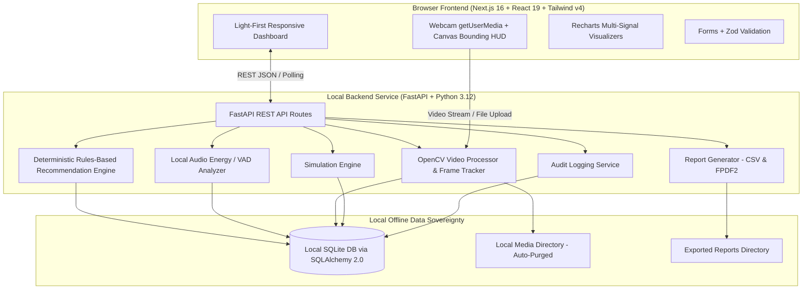

# System Architecture — Multimodal Attendance & Engagement Agent

## 1. High-Level Architecture Overview

## 2. Processing Pipeline

1. **Ingestion Modalities**:
   - **Simulated Mode**: Deterministic timeline generated with seed=42 for rapid offline demonstration and QA.
   - **Live Camera**: Browser captures frames through `getUserMedia`, tracks anonymous presence bounding boxes on HTML5 canvas.
   - **Video Upload**: Encoded MP4/AVI/MOV lecture video decoded frame-by-frame with OpenCV.

2. **Computer Vision Presence Tracking**:
   - Frames sampled at configurable interval (default: 1.0s).
   - Motion contour detection and presence bounding boxes.
   - Anonymous track IDs (`track_01`, `track_02`, etc.) preserved across consecutive frames via IoU matching.
   - Observation threshold: A track is only marked `present` after sustained observation exceeding the minimum threshold (default: 15s).
   - Occlusion tolerance: Brief exits (up to 15 frames) are tolerated before deactivating a track.

3. **Multimodal Fusion & Explainable Score**:
   - **Participation Activity (35%)**: Presence ratio and active body posture.
   - **Movement Frequency (25%)**: Frame-to-frame optical variation.
   - **Head Orientation (20%)**: Frontal orientation proxy.
   - **Voice Activity Ratio (20%)**: Acoustic energy and VAD speech distribution.
   - **Renormalization**: Missing modalities are automatically excluded and remaining weights normalized to sum to 100%.

4. **Deterministic Teaching Recommendations**:
   - Offline rules evaluate sudden participation declines, prolonged continuous lectures (>25 mins), and audio activity contexts.
   - Every recommendation includes supporting evidence, interval, confidence, and suggested action.
