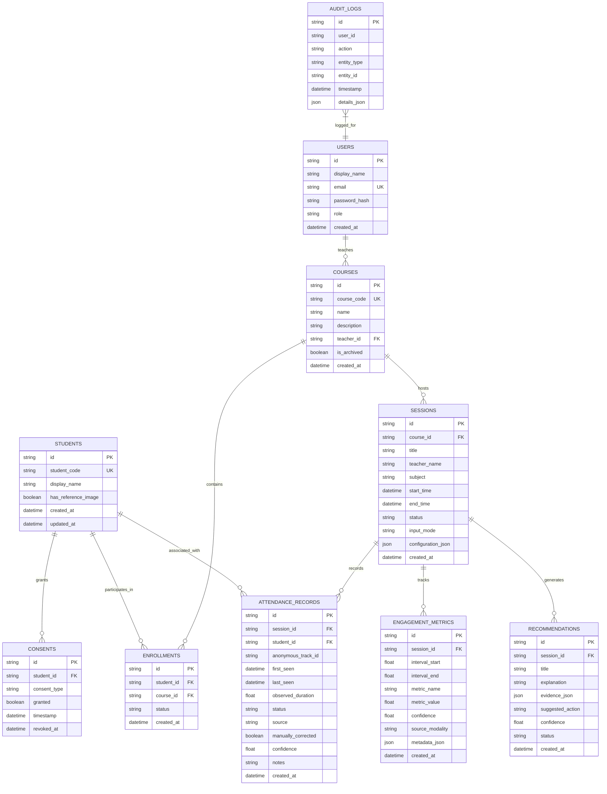

# Database Schema — Multimodal Attendance & Engagement Agent

## 1. Entity-Relationship Diagram

## 2. Table Specifications

### Users
- `id`: UUID Primary Key
- `display_name`: Full name of teacher or administrator
- `email`: Unique login identifier
- `role`: Role (`teacher`, `admin`, `observer`)

### Courses
- `id`: UUID Primary Key
- `course_code`: Unique institutional course code (e.g., `CS-402`)
- `name`: Course title
- `teacher_id`: Foreign key to `users.id`

### Students
- `id`: UUID Primary Key
- `student_code`: Unique identifier (e.g., `STU-1001`)
- `display_name`: Student full name
- `has_reference_image`: Opt-in local reference image flag

### AttendanceRecords
- `id`: UUID Primary Key
- `session_id`: Foreign key to `sessions.id` (Cascading delete)
- `student_id`: Nullable foreign key to `students.id`
- `anonymous_track_id`: Anonymous vision tracker identifier (e.g. `track_01`)
- `status`: `present`, `late`, `left_early`, `unverified`, `manually_confirmed`, `absent`
- `manually_corrected`: Boolean audit indicator
- `confidence`: Statistical detection score (0.0 to 1.0)

### EngagementMetrics
- `id`: UUID Primary Key
- `interval_start` & `interval_end`: Elapsed session seconds
- `metric_name`: `participation_activity`, `movement_frequency`, `head_orientation_indicator`, `voice_activity_ratio`, `composite_engagement`
- `metric_value`: Normalized 0.0 – 100.0 score
- `source_modality`: `video`, `audio`, `multimodal`, `simulated`

### Recommendations
- `id`: UUID Primary Key
- `title` & `explanation`: Explainable recommendation description
- `evidence_json`: Observed intervals, values, and limitations
- `status`: `pending`, `accepted`, `dismissed`, `completed`

### AuditLogs
- `id`: UUID Primary Key
- `action`: Operations including `CORRECT_ATTENDANCE`, `PURGE_SESSION_DATA`, `SEED_DEMO_DATA`
- `details_json`: Detailed payload of changed attributes
